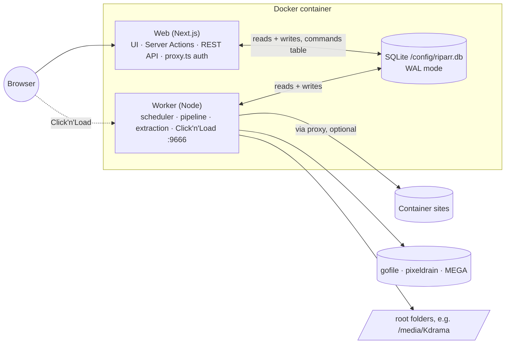
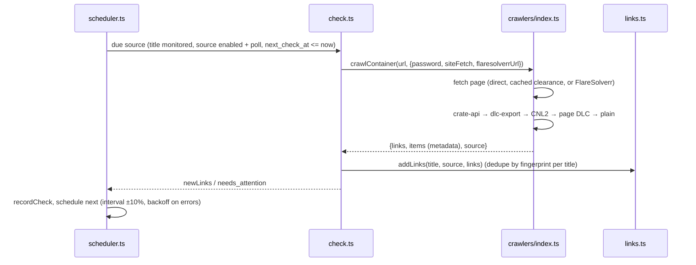
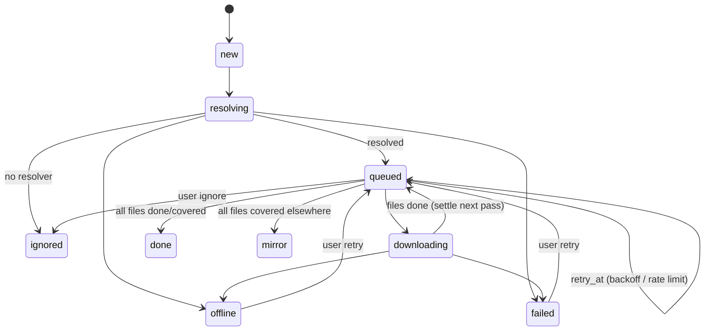

# Architecture

## Processes



Riparr is two processes that share one SQLite database:

- **Web**:
  - The Next.js 16 App Router serves the UI and the REST API.
  - Pages read the database during request-time rendering, with Cache Components on.
  - Mutations are Server Actions.
  - `proxy.ts` (Next 16's renamed middleware) guards every route.
- **Worker** (`worker/index.ts`): a loop that ticks every 2 seconds. Each tick:
  1. claims pending **commands** from the UI;
  2. runs due **source checks**;
  3. runs the **download pipeline**.

  It also hosts the Click'n'Load HTTP listener and writes a heartbeat to `settings` every 5 seconds.

The two processes never call each other. The UI writes rows directly, for example adding a title or retrying a link. For anything that touches running work, it puts a command in the `commands` table (`lib/commands.ts`): `check_now` (one source), `check_title`, `cancel_link`, `cancel_title`, `extract_title` or `scan_title`. The worker claims commands in a transaction.

`docker/entrypoint.sh` runs both processes under `tini` and `gosu` as `PUID`:`PGID`. If either exits, the container exits, so the restart policy can recover.

## Source checks



- **Crawler sources** (`lib/crawlers/`), tried in this order:

  | Source | File | Handles |
  | --- | --- | --- |
  | `crate-api` | `crate-api.ts` | Pages like mkvdrama. XOR-obfuscated token, key and IV in `data-*` attributes; the API returns an AES-GCM-encrypted JSON list. |
  | `dlc-export` | `index.ts` | Pages like viewcrate. `/api/dlc_url/<id>` points to a DLC file. |
  | `cnl2` | `cnl2.ts` | Click'n'Load forms and inline JavaScript. AES-128-CBC; the `jk` key script is evaluated in a sandboxed `node:vm`. |
  | `dlc` | `dlc.ts` | `.dlc` links on the page. Decrypted with JDownloader's DLC service, then XML parsed with regexes (no entity expansion). |
  | `plain` | `plain.ts` | Known host URLs anywhere in the HTML (`known-hosts.ts`) |

- **Error outcomes:**
  - Captchas, passwords, challenges and pages that are gone (404/410) throw `NeedsAttentionError`, and the source status becomes `needs_attention`.
  - A site's 429 throws `RateLimitError`, and the next check happens after `Retry-After`.
  - Anything else is `error`, with exponential backoff of the poll interval (capped at 6 hours).
- **Link identity:** `fingerprint` comes from `normalizeLinkUrl()`, which picks a canonical host and drops tracking parameters, but keeps MEGA's `#key` fragment. It's unique per title, so polling is idempotent and two sources listing the same link share one row (`source_id` remembers the first finder).

## Download pipeline

`worker/pipeline.ts` `scheduleDownloads()` runs every tick:

```mermaid
flowchart TD
  H[holdLimitedHosts · notifyLongLimits] --> A
  A[unresolvedLinks] -->|resolveQueue, 4 at once| R[resolveLink: resolver.resolve → upsertFiles as standby, season/episode parsed → markResolved]
  R --> SEL{titlesWithActiveLinks:<br/>resolvingInProgress?}
  SEL -->|no| P[planMirrors → promote / standby]
  P --> ST[settleLinks → done / mirror]
  SEL -->|yes, wait| ST
  ST --> D{diskIsLow(title's root)?}
  D -->|no| Q[downloadableLinks → host queue → global queue]
  Q --> DL[downloadLink: re-resolve, downloadFile each queued file]
  DL -->|link back to queued| ST
```

0. **Host cooldowns** (`lib/host-status.ts`). A `RateLimitError` of 2 minutes or more records a host-wide limit in `host_status`. While it lasts, `holdLimitedHosts` sets `retry_at` on every pending link of that host, so they lose priority in mirror selection and nothing new starts there. `notifyLongLimits` raises a *needs attention* notification when a host stays limited for long. **Try now** in the Queue clears the limit.
1. **Resolve.** The link's `HostResolver` (`lib/hosts/`) lists its `RemoteFile`s. New files are inserted with status `standby`, with `season`/`episode` from the link's metadata or the file name (`lib/episodes.ts`), and `links.resolved_at` is set.
2. **Select** (`lib/mirrors.ts`, pure). This runs per title, across all its sources, and waits until no link of the title is still `new` or `resolving`, so a fast host doesn't win just by answering first. Files are grouped by NFC-normalized, case-folded name and size. The rules within a group:
   - **A copy is done or skipped:** every other copy goes on standby and counts as *covered*.
   - **A copy is downloading:** every other copy goes on standby.
   - **Otherwise:** the usable copies are ranked:
     1. not waiting (no `retry_at` in the future, no host cooldown) first,
     2. fewer than 2 consecutive stalls,
     3. then by host rank in `settings.hostPriority`,
     4. then by discovery time,
     5. then by file id.

     The best copy is queued and the rest go on standby.

   Before planning, `coveredByDisk` (`lib/mirrors.ts`, pure) marks pending copies `skipped` when the title's folder already has that episode (or, for a movie, a video file) that Riparr didn't download; see *Folder scans* below.

   Running it again on its own output is a no-op; property tests check this.
3. **Download.** Links with `queued` files go through a per-host `PQueue` and then a global `PQueue`, in that order, so one busy host can't take every slot. `downloadLink` re-resolves the link for fresh download handles, then calls `downloadFile` (`lib/download.ts`) for each file:
   - partial data goes to `<root>/.riparr-partial/<fileId>.part`, on the same filesystem as the destination;
   - it resumes with an HTTP Range request (`RemoteFile.open(offset)` reports the offset the host actually honoured);
   - a download with no data for `settings.stallMinutes` is aborted with a `StallError` and resumed shortly after;
   - size and hash are checked, and bytes are counted in `host_usage`;
   - the finished file moves atomically to `fileDestination()` (`lib/titles.ts`): `<root>/<folder>/[Season NN/]<naming>`, kept inside the root by `resolveInside`.
4. **Settle.** A link whose files are all done, skipped or covered becomes `done`, or `mirror` if none of its own files were used. That triggers the notifications and `linkSettled()`.
5. **Extract** (`worker/extract-runner.ts`). When a title has no pending links, every folder it wrote to is scanned for archive sets (`worker/extract.ts` `findArchiveSets`). Each set is extracted with 7-Zip, one at a time, and recorded in `extractions`. Extraction waits for the title to settle because 7-Zip misreports sets with parts still downloading.

### Folder scans

`lib/disk-scan.ts` `scanTitle()` walks `<root>/<folder>` (hidden entries skipped, 3 levels deep) for video files and stores them in `disk_files` with the season and episode parsed from the name. The worker scans a title on the `scan_title` command (sent when a title is added or edited, and by **Rescan folder**), when a check finds new links, before the first mirror selection of a title never scanned, and every 30 minutes (a few titles per tick). `externalDiskFiles()` returns the files no `done` file row points at; those are what count as already on disk, in the pipeline and in the UI. If the root folder is missing, the previous scan's rows are kept.

### Failure handling

| Error | Link becomes | Files |
| --- | --- | --- |
| `HostOfflineError` | `offline` | `failed`, so mirrors take over |
| `RateLimitError` | `queued` with `retry_at` (attempt not counted); ≥ 2 min also starts a host cooldown | `standby` (parked) |
| `StallError` | `queued`, `attempts+1`, retried shortly | `standby` (parked), `stalls+1` |
| No resolver for host | `ignored` (quietly) | |
| `NeedsAttentionError` or 5th attempt | `failed` (notifies) | `failed` |
| Other errors | `queued`, `attempts+1`, `retry_at` (1 m × 2ⁿ, capped at 6 h) | `standby` (parked) |
| Abort (shutdown or user cancel) | back to `queued` unless the UI already changed it | `queued` |

`recoverInterrupted()` at worker start moves `resolving`/`downloading` work back to `queued`.

## State machines

### Link status



### File status

`standby` → `queued` (chosen) → `downloading` → `done` | `skipped` (identical file already at the destination) | `failed`. A file goes from `queued` back to `standby` when another copy is preferred.

### Source and title status

A source is `pending` → `ok` | `needs_attention` | `error`. A title's status rolls up from its sources (`rollUpStatus`): *paused* when not monitored, otherwise the worst of `needs_attention`, `error`, `pending`, else `ok`.

## Data model

`lib/db/migrations.ts` is an append-only list of migrations tracked by `PRAGMA user_version`, applied in a `BEGIN IMMEDIATE` transaction. Both processes call it at startup; before upgrading an existing database, `migrate()` writes a backup to `/config/backups` with `VACUUM INTO` (`lib/db/backup.ts`).

| Table | Purpose |
| --- | --- |
| `root_folders` | Library folders (absolute paths inside the container) |
| `titles` | Shows and movies: type, name, year, TMDB id and poster path, `root_folder_id`, `folder`, `season_folders`, `naming`, `monitored` |
| `sources` | Pages watched for a title: URL, password, `poll_interval_min`, `enabled`, `poll`, schedule (`next_check_at`), status |
| `links` | Discovered links, unique per `(title_id, fingerprint)`, with the `source_id` that found them: status, attempts, `retry_at`, `resolved_at`, `archive_password`, and metadata (`label`, `episode`, `quality`, `size_text`) |
| `files` | Files behind a link, unique per `(link_id, key)`: name, `dir`, size, hash, `season`, `episode`, `local_path`, `bytes_done`, `speed_bps`, `stalls`, status |
| `extractions` | One row per archive set (absolute `entry_path`): result and error |
| `host_status` | Per-host cooldown (`limited_until`, reason) and last success/error |
| `host_usage` | Bytes per host per UTC day, for the dashboard chart and the sidebar |
| `episodes` | Each matched show's episodes and air dates from TMDB, refreshed twice a day by `lib/schedule.ts` (movies keep `titles.release_date`); the Calendar joins them with files and folder scans for each episode's state |
| `disk_files` | Video files found in each title's folder by the last scan (`titles.disk_scanned_at`) |
| `settings` | Key/value JSON: app settings, auth (password hash, session secret, credential version), API key, worker heartbeat, disk status |
| `host_accounts` | Per-host credentials as JSON |
| `events` | Log entries: level (`debug`/`info`/`warn`/`error`), component, optional title (kept, unlinked, when the title is deleted). Written by `logEvent` (`lib/events.ts`), which also prints them for `docker logs`; debug only while enabled. Entries that are user-facing activity carry `activity` (a kind from `lib/activity.ts`) and `data` (JSON details: host, bytes, files…); History shows only those. Pruned after 30 days, debug after 3. |
| `commands` | UI → worker mailbox |

## Web app

- **Auth** (`lib/auth.ts`, `lib/session.ts`, `proxy.ts`):
  - Sessions are HMAC-signed cookie tokens carrying a credential version, so changing the password invalidates them all.
  - The proxy runs on the Node runtime, checks every page and `/api/*` route, and sends first-time visitors to `/setup`.
  - Every Server Action calls `requireSession()` itself.
  - `/api/health` is the only unauthenticated route.
- **UI** (`app/(app)/`): the app shell (`_shell/`: sidebar, top bar, theme toggle, polling `/api/v1/status` for badges and host state), the component kit (`_kit/`) and pages for the dashboard, Shows, Movies, title detail, Add/Edit title, Queue, History, Settings and System. Login and setup are in `app/(auth)/`. Colours come from the tokens in `app/tokens.css`, redefined for dark mode; the theme choice is applied before first paint by an inline script in `app/layout.tsx`.
- **TMDB** (`lib/tmdb.ts`): search and details for Add title, through the server only (the key never reaches the browser). Posters are cached under `/config/MediaCover` (`lib/media-cover.ts`) and served by `/api/v1/titles/<id>/poster`.
- **REST API** (`app/api/v1`): every handler is wrapped in `api()` (`lib/api.ts`), which awaits `connection()`, re-checks auth and maps `ApiError` and zod errors to JSON.
- **Live updates:** pages with active downloads render an `AutoRefresh` client component that calls `router.refresh()` every 3 seconds.
- **Secrets stay server-side:**
  - stored host-account secrets aren't sent back to forms;
  - the proxy URL is masked before it reaches a client component;
  - the API's `sourceDto` drops passwords;
  - notifications include only the title's id and name.

## Networking

- `lib/net.ts` `fetchFor("container" | "host")` returns either the global `fetch` or an undici fetch that goes through a `ProxyAgent` or `Socks5ProxyAgent`, depending on the proxy settings.
- Source-page requests (`CrawlOptions.siteFetch`) and, with the *Everything* scope, resolver API calls and downloads (`ResolveOptions.fetch`) use it.
- FlareSolverr, JDownloader's DLC service and notifications always connect directly.
- MEGA uses `megajs`'s own transport and is never proxied.
- The web app never loads `megajs`: `lib/hosts/mega.ts` imports it type-only and loads it with `import(/* turbopackIgnore: true */ "megajs")`, which the worker's esbuild bundle includes.
