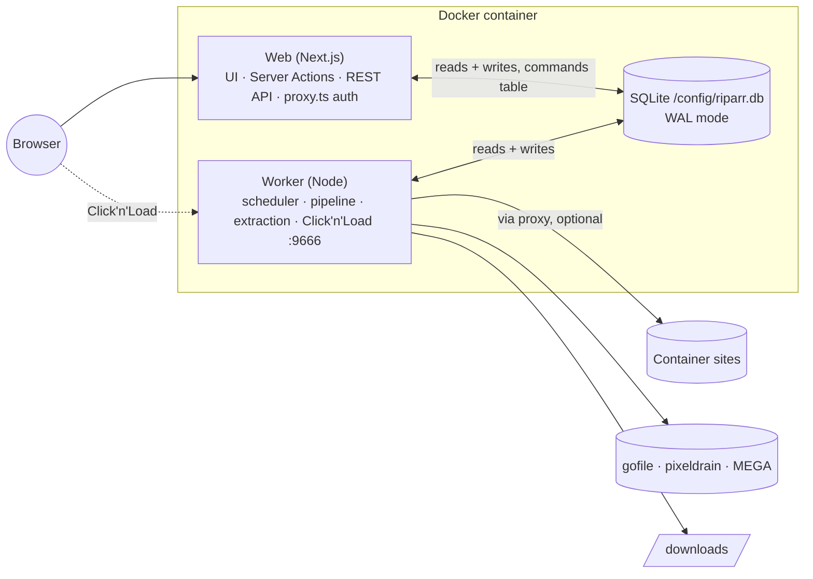
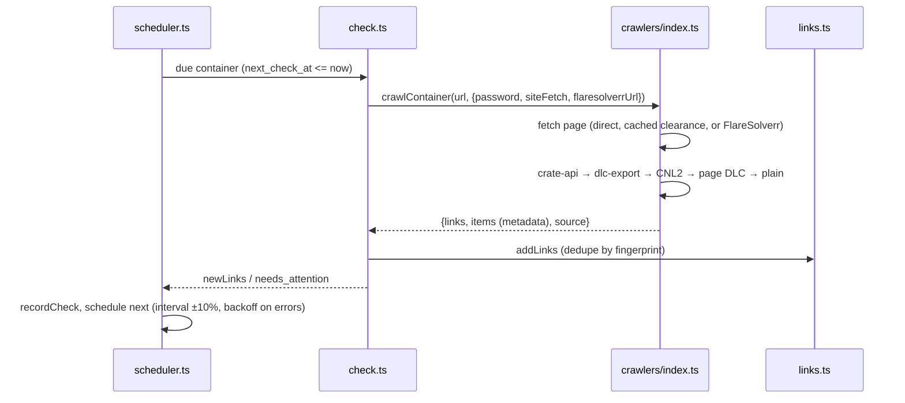
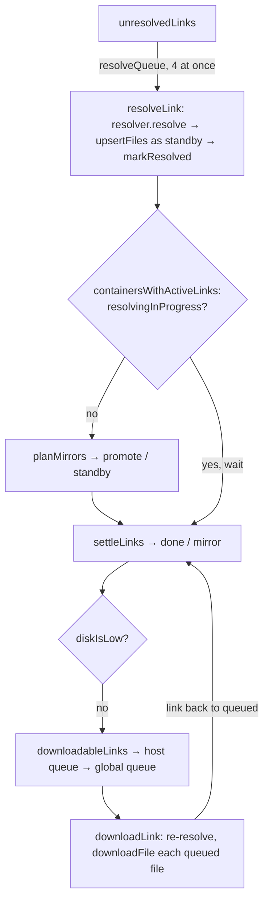
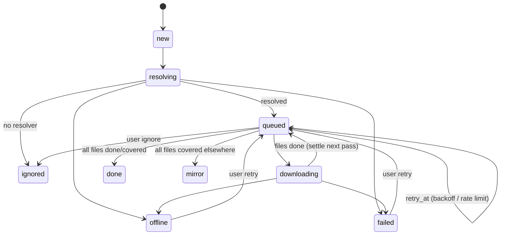

# Architecture

## Processes

Riparr is two processes that share one SQLite database:

- **Web**:
  - The Next.js 16 App Router serves the UI and the REST API.
  - Pages read the database during request-time rendering, with Cache Components on.
  - Mutations are Server Actions.
  - `proxy.ts` (Next 16's renamed middleware) guards every route.
- **Worker** (`worker/index.ts`): a loop that ticks every 2 seconds. Each tick:
  1. claims pending **commands** from the UI;
  2. runs due **container checks**;
  3. runs the **download pipeline**.

  It also hosts the Click'n'Load HTTP listener and writes a heartbeat to `settings` every 5 seconds.

The two processes never call each other. The UI writes rows directly, for example creating a container or retrying a link. For anything that touches running work, it puts a command in the `commands` table (`lib/commands.ts`): `check_now`, `cancel_link`, `cancel_container` or `extract_container`. The worker claims commands in a transaction.

`docker/entrypoint.sh` runs both processes under `tini` and `gosu` as `PUID`:`PGID`. If either exits, the container exits, so the restart policy can recover.

## Container checks

- **Crawler sources** (`lib/crawlers/`), tried in this order:

  | Source | File | Handles |
  | --- | --- | --- |
  | `crate-api` | `crate-api.ts` | Pages like mkvdrama. XOR-obfuscated token, key and IV in `data-*` attributes; the API returns an AES-GCM-encrypted JSON list. |
  | `dlc-export` | `index.ts` | Pages like viewcrate. `/api/dlc_url/<id>` points to a DLC file. |
  | `cnl2` | `cnl2.ts` | Click'n'Load forms and inline JavaScript. AES-128-CBC; the `jk` key script is evaluated in a sandboxed `node:vm`. |
  | `dlc` | `dlc.ts` | `.dlc` links on the page. Decrypted with JDownloader's DLC service, then XML parsed with regexes (no entity expansion). |
  | `plain` | `plain.ts` | Known host URLs anywhere in the HTML (`known-hosts.ts`) |

- **Error outcomes:**
  - Captchas, passwords and challenges throw `NeedsAttentionError`, and the container status becomes `needs_attention`.
  - A site's 429 throws `RateLimitError`, and the next check happens after `Retry-After`.
  - Anything else is `error`, with exponential backoff of the poll interval (capped at 6 hours).
- **Link identity:** `fingerprint` comes from `normalizeLinkUrl()`, which picks a canonical host and drops tracking parameters, but keeps MEGA's `#key` fragment. It's unique per container, so polling is idempotent.

## Download pipeline

`worker/pipeline.ts` `scheduleDownloads()` runs every tick:

1. **Resolve.** The link's `HostResolver` (`lib/hosts/`) lists its `RemoteFile`s. New files are inserted with status `standby`, and `links.resolved_at` is set.
2. **Select** (`lib/mirrors.ts`, pure). This waits until no link in the container is still `new` or `resolving`, so a fast host doesn't win just by answering first. Files are grouped by NFC-normalized, case-folded name and size. The rules within a group:
   - **A copy is done or skipped:** every other copy goes on standby and counts as *covered*.
   - **A copy is downloading:** every other copy goes on standby.
   - **Otherwise:** the usable copies are ranked:
     1. not waiting (no `retry_at` in the future) first,
     2. then by host rank in `settings.hostPriority`,
     3. then by discovery time,
     4. then by file id.

     The best copy is queued and the rest go on standby.

   Running it again on its own output is a no-op; property tests check this.
3. **Download.** Links with `queued` files go through a per-host `PQueue` and then a global `PQueue`, in that order, so one busy host can't take every slot. `downloadLink` re-resolves the link for fresh download handles, then calls `downloadFile` (`lib/download.ts`) for each file:
   - partial data goes to `.riparr-partial/<fileId>.part`;
   - it resumes with an HTTP Range request (`RemoteFile.open(offset)` reports the offset the host actually honoured);
   - size and hash are checked;
   - the finished file moves atomically to `resolveInside(root, target_dir/renderTemplate(...))`.
4. **Settle.** A link whose files are all done, skipped or covered becomes `done`, or `mirror` if none of its own files were used. That triggers the notifications and `linkSettled()`.
5. **Extract** (`worker/extract-runner.ts`). When a container has no pending links, every folder it wrote to is scanned for archive sets (`worker/extract.ts` `findArchiveSets`). Each set is extracted with 7-Zip, one at a time, and recorded in `extractions`. Extraction waits for the container to settle because 7-Zip misreports sets with parts still downloading.

### Failure handling

| Error | Link becomes | Files |
| --- | --- | --- |
| `HostOfflineError` | `offline` | `failed`, so mirrors take over |
| `RateLimitError` | `queued` with `retry_at` (attempt not counted) | `standby` (parked) |
| No resolver for host | `ignored` (quietly) | |
| `NeedsAttentionError` or 5th attempt | `failed` (notifies) | `failed` |
| Other errors | `queued`, `attempts+1`, `retry_at` (1 m × 2ⁿ, capped at 6 h) | `standby` (parked) |
| Abort (shutdown or user cancel) | back to `queued` unless the UI already changed it | `queued` |

`recoverInterrupted()` at worker start moves `resolving`/`downloading` work back to `queued`.

## State machines

### Link status

### File status

`standby` → `queued` (chosen) → `downloading` → `done` | `skipped` (identical file already at the destination) | `failed`. A file goes from `queued` back to `standby` when another copy is preferred.

### Container status

`pending` → `ok` | `needs_attention` | `error`. The *paused* label in the UI is `enabled = 0`.

## Data model

`lib/db/migrations.ts` is an append-only list of migrations tracked by `PRAGMA user_version`, applied in a `BEGIN IMMEDIATE` transaction. Both processes call it at startup.

| Table | Purpose |
| --- | --- |
| `containers` | Watched pages: URL, password, schedule (`next_check_at`), `enabled`, `poll`, target directory, template, status |
| `links` | Discovered links, unique per `(container_id, fingerprint)`: status, attempts, `retry_at`, `resolved_at`, `archive_password`, and metadata (`label`, `episode`, `quality`, `size_text`) |
| `files` | Files behind a link, unique per `(link_id, key)`: name, `dir`, size, hash, `local_path`, `bytes_done`, `speed_bps`, status |
| `extractions` | One row per archive set (`entry_path` relative to the downloads root): result and error |
| `settings` | Key/value JSON: app settings, auth (password hash, session secret, credential version), API key, worker heartbeat, disk status |
| `host_accounts` | Per-host credentials as JSON |
| `events` | Activity log, pruned after 30 days |
| `commands` | UI → worker mailbox |

## Web app

- **Auth** (`lib/auth.ts`, `lib/session.ts`, `proxy.ts`):
  - Sessions are HMAC-signed cookie tokens carrying a credential version, so changing the password invalidates them all.
  - The proxy runs on the Node runtime, checks every page and `/api/*` route, and sends first-time visitors to `/setup`.
  - Every Server Action calls `requireSession()` itself.
  - `/api/health` is the only unauthenticated route.
- **REST API** (`app/api/v1`): every handler is wrapped in `api()` (`lib/api.ts`), which awaits `connection()`, re-checks auth and maps `ApiError` and zod errors to JSON.
- **Live updates:** pages with active downloads render an `AutoRefresh` client component that calls `router.refresh()` every 3 seconds.
- **Secrets stay server-side:**
  - stored host-account secrets aren't sent back to forms;
  - the proxy URL is masked before it reaches a client component;
  - the API's `containerDto` drops passwords;
  - notifications include only the container's id and name.

## Networking

- `lib/net.ts` `fetchFor("container" | "host")` returns either the global `fetch` or an undici fetch that goes through a `ProxyAgent` or `Socks5ProxyAgent`, depending on the proxy settings.
- Container-site requests (`CrawlOptions.siteFetch`) and, with the *Everything* scope, resolver API calls and downloads (`ResolveOptions.fetch`) use it.
- FlareSolverr, JDownloader's DLC service and notifications always connect directly.
- MEGA uses `megajs`'s own transport and is never proxied.
- The web app never loads `megajs`: `lib/hosts/mega.ts` imports it type-only and loads it with `import(/* turbopackIgnore: true */ "megajs")`, which the worker's esbuild bundle includes.
